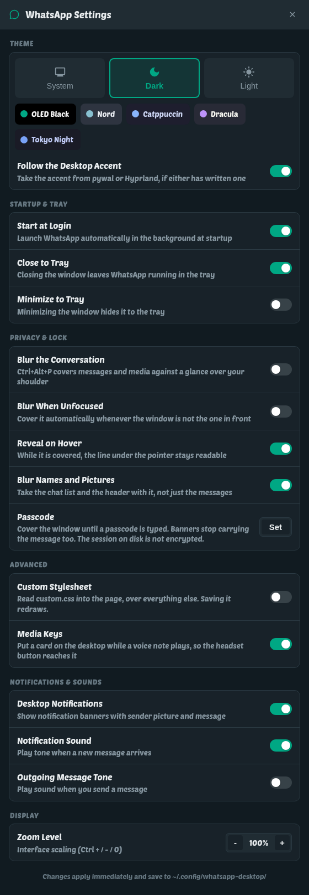
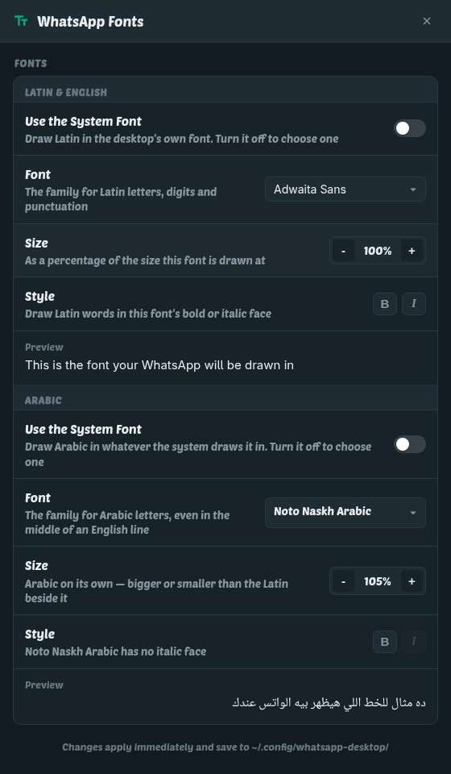
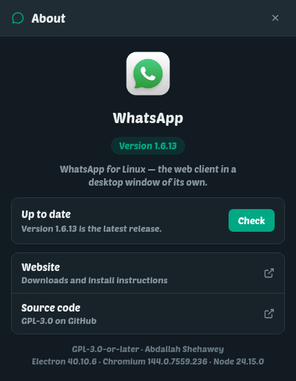

<p align="center">
  
</p>

<h1 align="center">whatsapp-desktop</h1>

<p align="center">
  An unofficial WhatsApp desktop client for Linux, built on Electron.<br>
  Tray icon, native notifications, themes, and right-to-left text that reads correctly.
</p>

<p align="center">
  <a href="https://github.com/abdallah-shehawey/whatsapp-desktop/releases/latest"></a>
  <a href="https://github.com/abdallah-shehawey/whatsapp-desktop/actions/workflows/ci.yml"></a>
  <a href="LICENSE"></a>
  <a href="https://abdallah-shehawey.github.io/whatsapp-desktop/"></a>
</p>

---

whatsapp-desktop opens `web.whatsapp.com` in its own window. You get the same
client WhatsApp gives a browser, so it doesn't reverse-engineer the protocol or
put your account at risk. On top of the web client it adds what a browser tab
can't do: a tray icon, a notification for each message, desktop-wide shortcuts,
a passcode lock and proper Arabic text.

<p align="center">
  
  
  
</p>

## Features

- **Runs in the tray.** Closing the window doesn't disconnect you, and it can start hidden at login. GNOME needs the [AppIndicator extension](https://extensions.gnome.org/extension/615/appindicator-support/) to show the icon.
- **Notifications.** One per message, with the sender, the text and their picture. Clicking one opens the chat, and it disappears once you read the message on any device. Muted chats stay silent unless someone mentions you.
- **Arabic and RTL text.** Each line follows the direction of its own text, so Arabic and English can share one message. Line spacing and timestamps are fixed too.
- **Themes.** System, dark, light, OLED Black, Nord, Catppuccin, Dracula or Tokyo Night. It can also take its accent color from pywal or Hyprland.
- **Fonts.** You can pick a family, size and style for Latin and another for Arabic. By default both follow the desktop font.
- **Privacy.** `Ctrl+Alt+P` blurs messages and contacts. An optional passcode locks the window when it's idle or when the desktop locks, and notifications can hide message text.
- **Calls and screen sharing.** The camera and microphone are allowed for WhatsApp only. On Wayland, you can share a window or the whole screen over PipeWire.
- **Global shortcuts.** Show or hide the window and mute yourself in a call from anywhere. On Wayland these go through the desktop portal.
- **Media keys.** Voice notes show up as a media player (MPRIS), so headset buttons control them.
- **Smooth.** Scrolling runs on the GPU and animations run on the compositor, so it moves more smoothly than a browser tab.
- **Update notices.** It checks GitHub once a day and tells you when a new version is out. Your package manager does the actual update.
- **No config file needed.** Every option is in the Settings and Fonts windows, and changes take effect right away.

## Install

### Package repository (recommended)

Add the [shinux repository](https://abdallah-shehawey.github.io/shinux-repo/), then install with your package manager. After that, updates come with the rest of your system.

```sh
curl -fsSL https://abdallah-shehawey.github.io/shinux-repo/install.sh | sudo sh
```

```sh
sudo dnf install --refresh whatsapp-desktop                # Fedora
sudo apt update && sudo apt install whatsapp-desktop       # Debian, Ubuntu 24.04+
sudo pacman -Syu whatsapp-desktop                          # Arch
```

If you'd rather add the repository by hand, the [website](https://abdallah-shehawey.github.io/whatsapp-desktop/#download) has the steps for each distribution.

### Release downloads

Every [release](https://github.com/abdallah-shehawey/whatsapp-desktop/releases/latest) has these files:

| Distribution | File | Install |
|---|---|---|
| Fedora | `whatsapp-desktop-<version>-1.x86_64.rpm` | `sudo dnf install ./whatsapp-desktop-*.rpm` |
| Debian, Ubuntu | `whatsapp-desktop_<version>_amd64.deb` | `sudo apt install ./whatsapp-desktop_*.deb` |
| Arch | `whatsapp-desktop-<version>-1-x86_64.pkg.tar.zst` | `sudo pacman -U ./whatsapp-desktop-*.pkg.tar.zst` |
| Any (AppImage) | `WhatsApp-Desktop-<version>-x86_64.AppImage` | `chmod +x` the file and run it |

To check a download, run `sha256sum -c SHA256SUMS --ignore-missing`. Every package ships its own Electron, so you don't need a browser installed.

The rpm, deb and Arch packages also install an autostart entry that starts the client hidden in the tray. To turn it off, use your desktop's startup settings or delete `/etc/xdg/autostart/io.github.shehawey.whatsapp-desktop.desktop`.

### npm (GitHub Packages)

You need a GitHub personal access token (classic) with the `read:packages` scope:

```sh
npm login --scope=@abdallah-shehawey --auth-type=legacy --registry=https://npm.pkg.github.com
npm install --global @abdallah-shehawey/whatsapp-desktop
whatsapp-desktop
```

The npm package doesn't add a menu entry. If you want one, use a native package.

### From source

You need Node.js 22 or newer and npm.

```sh
git clone https://github.com/abdallah-shehawey/whatsapp-desktop
cd whatsapp-desktop
make install      # installs to ~/.local, with a desktop entry and icons
make autostart    # optional: start hidden at login
```

To remove it, run `make uninstall`.

> [!NOTE]
> Official Fedora and Debian packages are under review with the name **Dardasha**, because distribution archives don't accept the WhatsApp name or logo on a third-party client. See [`packaging/official`](packaging/official/README.md).

## Keyboard shortcuts

| Keys | Action |
|---|---|
| `Ctrl+,` | Settings |
| `Ctrl+F` | Search the open chat, or the list on screen |
| `Ctrl+Alt+P` | Blur or reveal the conversation |
| `Ctrl+Alt+L` | Lock now (needs a passcode) |
| `Ctrl` `+` / `-` / `0` | Zoom in, zoom out, reset zoom |
| `Ctrl+R` | Reload |
| `Ctrl+W` | Close the window (the client stays in the tray) |
| `Ctrl+Q` | Quit |
| `Ctrl+Shift+I` | Developer tools |
| `Super+Alt+W` | Show or hide the window (global) |
| `Super+Alt+M` | Mute or unmute your microphone in a call (global) |

The first time you start the client on Wayland, the desktop asks you to confirm the global shortcuts. You can change them in the `[shortcuts]` section of the config file.

## Configuration

You can set everything from **Settings** (`Ctrl+,`) and **Fonts** (in the tray menu). Your choices are saved in `~/.config/whatsapp-desktop/whatsapp-desktop.conf`, and [docs/configuration.md](docs/configuration.md) lists every key. Your WhatsApp session is stored in `~/.local/share/whatsapp-desktop`.

## Documentation

- [Configuration reference](docs/configuration.md)
- [Troubleshooting](docs/troubleshooting.md): notifications, chat links, screen sharing, the GNOME tray
- [Contributing](CONTRIBUTING.md): development setup, tests, project layout
- [Security policy](SECURITY.md)

## Credits

Thanks to [@coach-nooreldean](https://github.com/coach-nooreldean) for the privacy shield, passcode lock, media controls, custom stylesheet, global shortcuts, palettes, CI and AppImage packaging ([#4](https://github.com/abdallah-shehawey/whatsapp-desktop/pull/4)).

## License

[GPL-3.0-or-later](LICENSE). The sources of the icons are listed in [`data/icons/NOTICE`](data/icons/NOTICE), and the website's fonts in [`docs/assets/FONTS-NOTICE.txt`](docs/assets/FONTS-NOTICE.txt).

This project is not affiliated with, endorsed or sponsored by WhatsApp or Meta. WhatsApp is a trademark of its owner.
